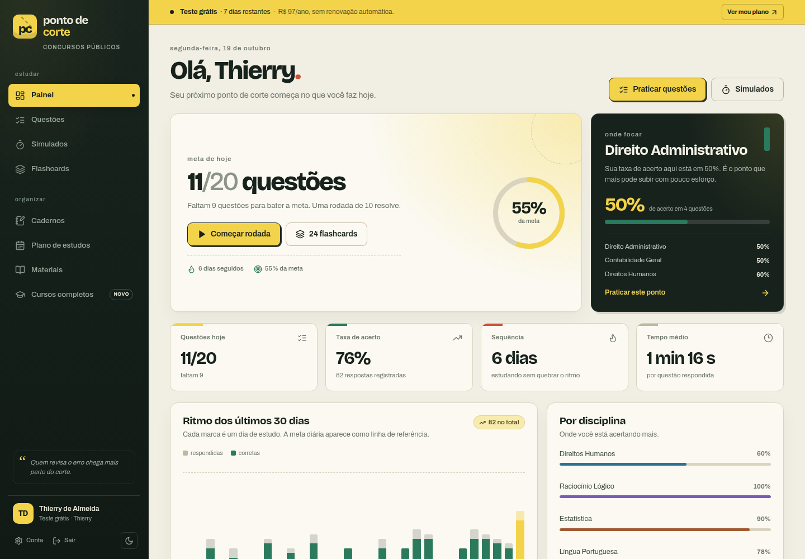
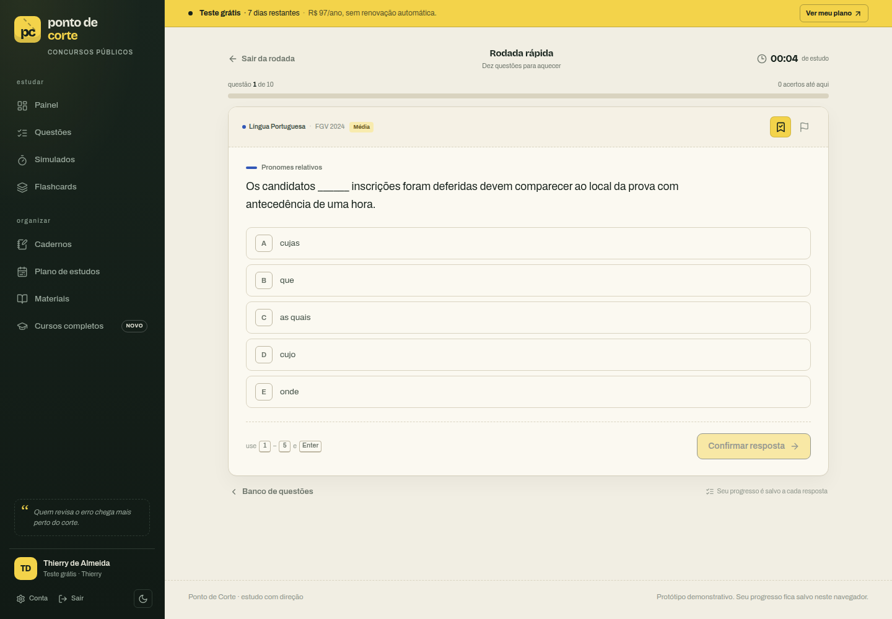
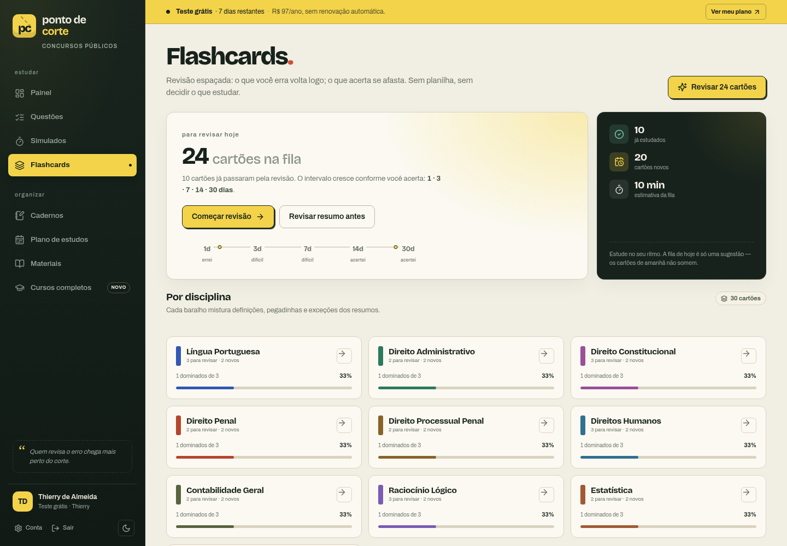
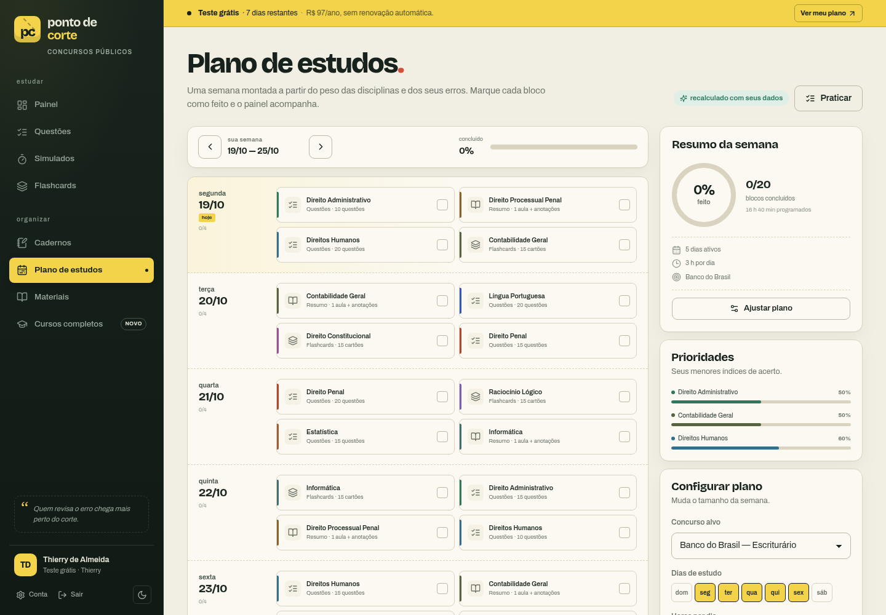

# Ponto de Corte

> Plataforma de estudos para concursos públicos: questões comentadas, simulados, flashcards com revisão espaçada, plano semanal e materiais de leitura — tudo em português, com uma identidade visual própria inspirada em papel, edital e marca-texto.



<table>
  <tr>
    <td width="50%"></td>
    <td width="50%"></td>
  </tr>
  <tr>
    <td colspan="2"></td>
  </tr>
</table>

## Sobre

**Ponto de Corte** é um protótipo funcional de app de estudos para concursos. A ideia central: transformar erro em direção. Cada resposta alimenta o painel, o caderno de erros, os flashcards e o plano da semana seguinte.

Sem backend: todo o estado é salvo no `localStorage` do navegador e a base de conteúdo é demonstrativa (autoral), o que torna o projeto fácil de rodar e explorar.

## Funcionalidades

**Estudar**
- **Painel** com meta diária, sequência de dias, tempo médio, ritmo dos últimos 30 dias e foco por disciplina.
- **Questões** com filtros por busca, disciplina, banca, dificuldade e "só não respondidas", com paginação e ordenação.
- **Prática** em dois modos: correção imediata (rodadas avulsas, caderno) ou **simulado cronometrado** com gabarito só no final.
- **Flashcards** com revisão espaçada (intervalos de 1 · 3 · 7 · 14 · 30 dias) e avaliação errei/difícil/acertei.
- **Materiais** de leitura por disciplina, com marcação de aula lida e progresso.
- **Cursos completos** com módulos, aulas e progresso por aula.

**Organizar**
- **Caderno de erros** automático (a questão sai quando você acerta de novo) e **caderno de favoritas**.
- **Plano de estudos** semanal gerado a partir do peso da disciplina, da sua taxa de acerto e do tempo disponível — com checkoff de blocos e ajuste de dias/horas.
- **Minha conta** com preferências, meta diária, troca de tema (claro/escuro), assinatura demonstrativa e reset de progresso.

## Stack

| Camada | Escolha |
| --- | --- |
| UI | React 19 + TypeScript |
| Build | Vite 6 |
| Rotas | React Router 7 |
| Ícones | lucide-react |
| Estilo | CSS puro com design tokens (temas claro/escuro, responsivo, print) |
| Estado | Context + hooks, persistência em `localStorage` |

## Rodando localmente

```bash
npm install
npm run dev
```

Abra `http://localhost:5173`. Se a porta estiver ocupada:

```bash
npm run dev -- --port 5174
```

Build de produção e pré-visualização:

```bash
npm run build
npm run preview
```

## Acesso de demonstração

- O app já abre **logado** com o perfil semeado “Thierry de Almeida” e progresso de exemplo.
- Em **Entrar**, qualquer e-mail válido + senha de 8 ou mais caracteres funciona.
- Em **Criar conta**, o progresso é zerado e um novo perfil é criado.
- Para voltar ao estado original: **Minha conta → Zona de cuidado → Apagar progresso**.

## Estrutura

```
src/
├─ components/        # Layout, marca, cartões, UI compartilhada e linha de questão
├─ data/              # Questões, flashcards, materiais, cursos e disciplinas (conteúdo demo)
├─ lib/               # Estatísticas, gerador do plano e utilidades de data/formatação
├─ pages/             # Uma página por rota (painel, questões, prática, plano, conta…)
├─ styles/            # Design tokens, base e CSS por área
├─ store.tsx          # Estado global, seed de demonstração e ações
└─ types.ts           # Tipos do domínio
```

## Conteúdo demonstrativo

- 40 questões autorais comentadas, em 10 disciplinas, no estilo das principais bancas.
- 30 flashcards e 20 aulas de resumo.
- 4 cursos completos, com módulos e aulas.
- Dados semeados de respostas, favoritas, leituras e progresso para o painel já nascer “vivo”.

## Design

Identidade de papelaria/edital: fundo de papel quente, sidebar verde-tinta, marca-texto amarelo e acentos em coral e verde. Tipografia **Bricolage Grotesque** (títulos) + **Archivo** (texto). Os tokens ficam em `src/styles/base.css`, com tema escuro aplicado via `data-theme`.

## Aviso

Projeto demonstrativo, sem vínculo com bancas, concursos ou instituições citadas. Nenhum dado sai do navegador. O conteúdo é autoral e serve para explorar a experiência do produto — não substitui materiais oficiais de estudo.
